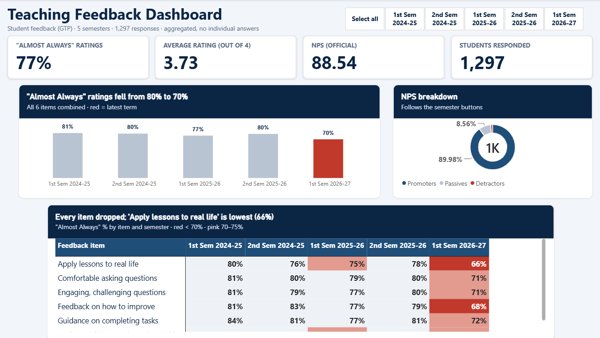

# 🎓 Teaching Feedback Dashboard
### Is my teaching slipping, and why? A 5-semester look at my own student feedback


> **A data analytics case study on my own work.** As a university faculty member, I analyzed 5 semesters of student feedback (GTP) to find out whether my teaching quality is changing, which areas are dropping, and what students are saying.



---

## 📌 TL;DR
| | |
|---|---|
| **Question** | Is my teaching quality slipping? |
| **Answer** | **Yes, partly.** "Almost Always" ratings fell from **80% to 70%** in the latest semester |
| **But** | Students still recommend the class: **NPS stays above 87** |
| **Why** | "Too fast" comments jumped from **1 to 8**, and **every** feedback item dropped. "Apply lessons to real life" is the lowest (**66%**) |

---

## 1. The problem
At the end of each semester, students rate their teacher on 6 items (understanding, guidance, comfort asking questions, engaging questions, feedback, real-life application) and leave written comments.

Looking at one semester at a time hides **trends**. I wanted to see:
1. Is my rating going up or down across semesters?
2. **Which** teaching behaviors are slipping?
3. **What** are students actually complaining about?

## 2. Data
| Table | Contents |
|---|---|
| `Dim_Term` | 5 semesters (1st Sem 2024-25 → 1st Sem 2026-27), with respondent counts |
| `Dim_Item` | The 6 feedback items |
| `Fact_Responses` | Number of students per term × item × answer level (Almost Always / Often / Sometimes / Rarely) |
| `Fact_NPS` | Promoters, passives, detractors and the official NPS per term |
| `Fact_CommentThemes` | Keyword counts in written comments (fast pacing, late announcements, subject is hard) |

**1,297 responses** across 5 semesters. Typed from the official feedback reports. **Aggregated only:** no individual answers or student names.

## 3. Method
- **Star schema data model:** `Dim_Term` and `Dim_Item` filter three fact tables.
- **DAX measures:**
  ```DAX
  Almost Always % = DIVIDE(
      CALCULATE(SUM(Fact_Responses[Count]), Fact_Responses[Level] = "Almost Always"),
      SUM(Fact_Responses[Count]))

  Avg Rating = DIVIDE(
      SUMX(Fact_Responses, Fact_Responses[LevelScore] * Fact_Responses[Count]),
      SUM(Fact_Responses[Count]))
  ```
- **"Almost Always" %** is used to compare terms, because one semester's report used a different rating scale.
- **Semester buttons** filter the KPI cards and the NPS donut. The trend chart and item grid always show all 5 terms.

## 4. Key findings
1. **"Almost Always" ratings were stable at about 80% for 4 semesters, then fell to 70%** in 1st Sem 2026-27.
2. **The drop hit every item at once**, which points to a common cause rather than one weak skill.
3. **"Apply lessons to real life" is the weakest item (66%)**, followed by "Feedback on how to improve" (68%).
4. **"Too fast" comments jumped from 1 to 8** in the same semester. **Pacing** is the most likely cause.
5. **Satisfaction is still high:** NPS stayed above 87 in every term. Students still recommend the class, but they're struggling to keep up.

## 5. Actions I'm taking
- **Slow the pace:** add one worked example before each problem set.
- **Real-life application in every lesson:** link concepts to real equipment and industry cases.
- **Clearer communication:** post announcements in one channel, 48 hours ahead.
- **Next check:** compare next semester's results with this baseline.

## 6. Limitations
- Comment themes are **approximate keyword counts**, not full text analysis.
- Item wording changed slightly in 2025-26; the short item names describe the same idea.
- Small changes (±2 points) may be noise. Only the latest drop is clearly outside the normal range.

## 7. Files in this repo
| File | Contents |
|---|---|
| `GTP_Feedback_Dashboard.pbix` | Power BI dashboard |
| `GTP-Feedback-Data.xlsx` | Aggregated data tables, with a README sheet |
| `gtp_overview.png` | Dashboard screenshot |

---
**Jarred Tañedo** · Mechanical Engineering faculty → Data Analyst
🔗 [LinkedIn](https://www.linkedin.com/in/jarred-jeff-bandong-ta%C3%B1edo-367667354) · 🌐 Portfolio *(coming soon)*
